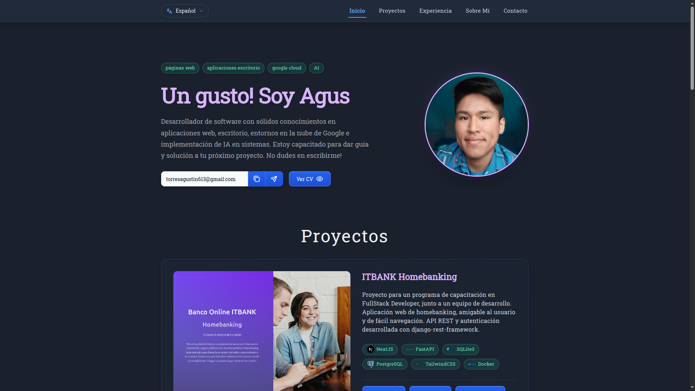

# 🚀 Agustín Torres — Portfolio Personal & Profesional

<div align="center">



[](https://astro.build/)
[](https://tailwindcss.com/)
[](https://www.typescriptlang.org/)
[](https://nodejs.org/)
[](#-internacionalización-i18n)

**Portafolio de desarrollo de software, proyectos técnicos, experiencia profesional y visor interactivo de currículum.**

[Explorar Demo](#-características-principales) • [Tecnologías](#-stack-tecnológico) • [Estructura](#-estructura-del-proyecto) • [Instalación](#-instalación-y-desarrollo)

</div>

---

## 🌟 Características Principales

- **🌐 Sistema de Internacionalización Bilingüe (i18n):**
  - Soporte nativo para Español (`/es/`) e Inglés (`/en/`) mediante enrutamiento estático de Astro.
  - Selector de idioma dinámico que preserva la ruta actual tanto en la página principal como en el visor de CV.
  - Textos organizados en diccionarios jerárquicos únicos (`src/i18n/locales/`).

- **🎨 Interfaz Moderna & Sistema de Diseño Unificado:**
  - Estética *Dark Slate* con efectos de *glassmorphism* (`backdrop-filter: blur`), bordes sutiles y acentos en púrpura y azul eléctrico.
  - Totalmente adaptativo y responsive en smartphones, tablets y pantallas de escritorio.
  - Header superior sticky con *Scroll Spy* mediante `IntersectionObserver` que resalta automáticamente la sección en pantalla.

- **🛠️ Catálogo de Tecnologías Categorizado:**
  - Sección dedicada organizada en 4 áreas técnicas: *Frontend*, *Backend*, *Bases de Datos & Cloud*, y *Desktop & Hardware*.
  - Íconos vectoriales inyectados en tiempo de compilación con cero JavaScript en el cliente mediante `astro-icon`.

- **🔍 Filtrado Interactivo de Proyectos:**
  - Sistema de filtrado interactivo por tecnología con contadores en tiempo real.
  - Permite filtrar proyectos por múltiples tecnologías simultáneas o restablecer la vista con un solo clic.

- **⏱️ Línea de Tiempo de Experiencia:**
  - Presentación visual de hitos laborales y formativos en formato timeline con nodos iluminados, insignias de fechas y enlaces a repositorios y demostraciones.

- **🎓 Sección "Sobre Mí" con Pestañas Sub-seccionales:**
  - Pestaña **Biografía**: Presentación personal con imagen de perfil y palabras clave destacadas.
  - Pestaña **Educación**: Formación universitaria (Ingeniería Informática - UBA), escuela secundaria técnica (Técnico Electromecánico) y certificaciones especializadas (Talento Tech GEAR en IA, Google Cloud GCP, ITBA Full Stack, Inglés B2).
  - Pestaña **Intereses & Visión**: Filosofía de desarrollo, pasiones tecnológicas y valores profesionales.

- **📄 Visor Integrado de CV (PDF.js):**
  - Rutas dedicadas `/es/resume` y `/en/resume`.
  - Renderizado en canvas con `pdfjs-dist` y worker local con polyfill para compatibilidad en todos los navegadores y WebViews móviles.
  - Controles de zoom, ajuste al ancho de pantalla (`fit-to-width`), paginación y descarga directa del documento.

- **📱 Optimización para Redes Sociales (Open Graph & SEO):**
  - Metadatos completos configurados para vistas previas enriquecidas en WhatsApp, LinkedIn, Twitter/X, Facebook e Instagram.

---

## 💻 Stack Tecnológico

| Capa | Tecnología | Propósito |
|---|---|---|
| **Framework** | [Astro](https://astro.build/) v7.4 (SSG) | Generación de sitio estático de alto rendimiento y cero JS por defecto |
| **Estilos** | [Tailwind CSS](https://tailwindcss.com/) v4.3 + CSS Scoped | Diseño atómico, animaciones y tokens de diseño |
| **Lenguaje** | [TypeScript](https://www.typescriptlang.org/) | Tipado estático en modelos de datos, helpers y componentes |
| **Íconos** | [astro-icon](https://github.com/natemoo-re/astro-icon) + Iconify | Íconos vectoriales (`@iconify-json/logos`, `@iconify-json/tabler`) inlined en build time |
| **Documentos** | [PDF.js](https://mozilla.github.io/pdf.js/) (`pdfjs-dist` v4.10) | Motor de renderizado en canvas para el visor de CV |
| **Fuentes** | *Roboto Slab* | Tipografía serif moderna gestionada por `@astrojs/font` |
| **Entorno** | Node.js v26.x (LTS) | Runtime fijado en `.nvmrc` |

---

## 📁 Estructura del Proyecto

```
personal-portfolio/
├── public/                     # Archivos estáticos
│   ├── favicon.ico / .png      # Favicons del sitio
│   ├── personal-portfolio-preview.png # Vista previa para redes sociales y README
│   ├── portrait.jpg            # Foto de perfil para Sobre Mí
│   ├── profile_image.png       # Avatar principal del Hero
│   ├── torres-facundo-cv-*.pdf # Archivos PDF descargables (ES / EN)
│   ├── pdfjs/                  # Worker local de PDF.js
│   └── projects/               # Capturas y vistas previas de proyectos
├── src/
│   ├── components/             # Componentes modulares y secciones
│   │   ├── about_me/           # Sección Sobre Mí (pestañas Biografía, Educación, Intereses)
│   │   ├── experience/         # Línea de tiempo de experiencia
│   │   ├── footer/             # Pie de página y enlaces de contacto
│   │   ├── header/             # Barra de navegación sticky y selector de idioma
│   │   ├── hero/               # Banner principal de presentación
│   │   ├── project/            # Proyectos y filtrado dinámico por tecnología
│   │   ├── technologies/       # Catálogo de tecnologías dominadas
│   │   └── ...                 # Botones, títulos, badges y componentes base
│   ├── data/                   # Datos desacoplados (experiencias, proyectos, tecnologías)
│   ├── i18n/                   # Sistema de internacionalización
│   │   ├── locales/            # Diccionarios es.json y en.json
│   │   ├── ui.ts               # Configuración de locales y tipos
│   │   └── utils.ts            # Helpers de traducción y enrutamiento
│   ├── layouts/                # Plantilla base HTML con metadatos Open Graph
│   ├── pages/                  # Rutas estáticas (/es/, /en/, /es/resume, /en/resume)
│   ├── styles/                 # Estilos globales y configuración Tailwind
│   └── types/                  # Interfaces de TypeScript
├── astro.config.mjs            # Configuración de Astro, i18n y fuentes
├── package.json                # Scripts y dependencias
└── tsconfig.json               # Configuración de TypeScript
```

---

## 🛠️ Instalación y Desarrollo

### Requisitos Previos

- **Node.js:** Versión `>= 20.0.0` (recomendada v26 LTS, especificada en `.nvmrc`).
- **NPM:** Gestor de paquetes incluido con Node.js.

### Pasos

1. **Clonar el repositorio:**
   ```bash
   git clone https://github.com/AgusT613/personal-portfolio.git
   cd personal-portfolio
   ```

2. **Instalar dependencias:**
   ```bash
   npm install
   ```

3. **Iniciar el servidor de desarrollo:**
   ```bash
   npm run dev
   ```
   Abre [http://localhost:4321](http://localhost:4321) en tu navegador para ver la aplicación.

4. **Compilar para producción (Build estático):**
   ```bash
   npm run build
   ```
   Los artefactos estáticos listos para desplegar en Netlify, Vercel o GitHub Pages se generarán en la carpeta `dist/`.

5. **Previsualizar el build de producción:**
   ```bash
   npm run preview
   ```

---

## 👤 Contacto y Redes

- **Desarrollador:** Agustín (Facundo) Torres
- **LinkedIn:** [linkedin.com/in/torres-facundo-agustin](https://www.linkedin.com/in/torres-facundo-agustin)
- **GitHub:** [@AgusT613](https://github.com/AgusT613)
- **Email:** [torresagustin613@gmail.com](mailto:torresagustin613@gmail.com)

---

<div align="center">
  Desarrollado con ❤️ usando <strong>Astro</strong> y <strong>Tailwind CSS</strong>.
</div>
